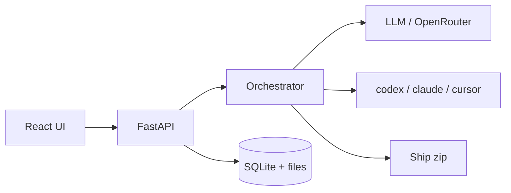

# ShipCrew

Мультиагентная платформа, которая доводит задачу до prod-ready бандла: PM → Architect → Engineer → Reviewer → DevOps. Для команд, которым нужен один контур от брифа до zip.

{{скриншот}}

## Возможности

- Проекты, шаблоны команд и shared blackboard между ролями
- OpenRouter OAuth и LLM HTTP API
- Subscription runners: Codex / Claude / Cursor (имена — продуктовые фичи)
- Metrics, event log, zip ship bundle
- React UI (Mission / Setup / Insights) + FastAPI v1
- Demo mode без ключей для локального прогона

## Архитектура



## Стек

Python 3.12 · FastAPI · pydantic-settings · React 19 · Vite · oxlint · Docker

## Запуск

```powershell
.\scripts\dev.ps1
```

Или:

```bash
cp .env.example .env
docker compose up --build
```

- UI: http://127.0.0.1:5173 (dev) / http://127.0.0.1:8787 (compose)
- API health: http://127.0.0.1:8787/api/health

```
backend/app/   api, domain, runners, persistence
frontend/src/  pages, components, hooks
docs/          architecture, api, runners
```

Проверки: `make test`, `make lint`, `make fmt`. Документы: [architecture](docs/architecture.md), [API](docs/api.md), [runners](docs/runners.md).

## Конфиг

| Переменная | Назначение |
| --- | --- |
| `SHIPCREW_LLM_*` | Base URL, key, model |
| `SHIPCREW_DEMO_MODE` | Fixture answers without a key |
| `SHIPCREW_DATA_DIR` | Projects and SQLite index |
| `SHIPCREW_HOST` / `PORT` | API bind |
| `SHIPCREW_FRONTEND_URL` | OAuth return |
| `SHIPCREW_PUBLIC_BASE_URL` | Callback origin |
| `SHIPCREW_*_TIMEOUT_S` | HTTP and runner timeouts |

Полный список — в `.env.example`.

## Автор

Богдан Щербинин ([blessed-bless](https://github.com/blessed-bless))

MIT.
