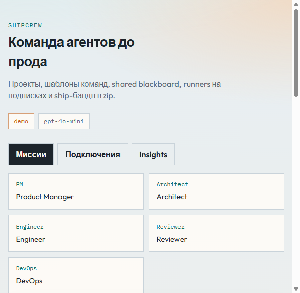
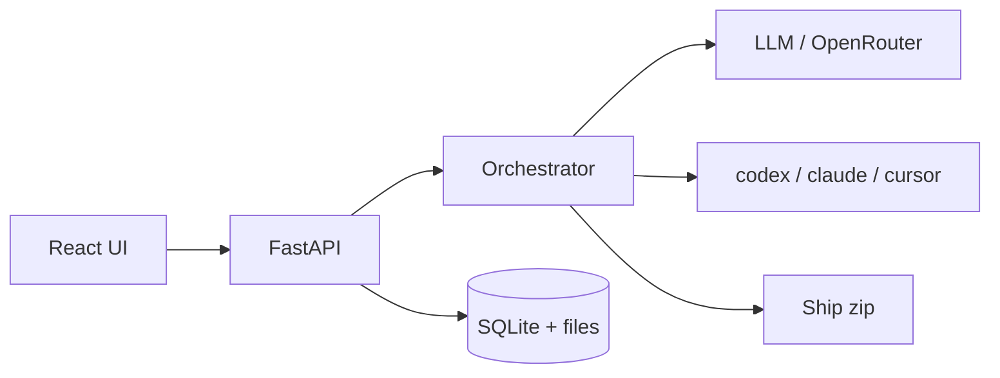

# ShipCrew

Мультиагентная платформа, которая доводит задачу до prod-ready бандла: PM → Architect → Engineer → Reviewer → DevOps. Для команд, которым нужен один контур от брифа до zip.



## Возможности

- Проекты, шаблоны команд и shared blackboard между ролями
- OpenRouter OAuth и LLM HTTP API
- Subscription runners: Codex / Claude / Cursor
- Metrics, event log, zip ship bundle
- React UI (Mission / Setup / Insights) + FastAPI v1
- Demo mode без ключей для локального прогона

## Архитектура



## Стек

Python 3.12 · FastAPI · pydantic-settings · React 19 · Vite · Docker

## Запуск

```bash
git clone https://github.com/blessed-bless/shipcrew.git
cd shipcrew
cp .env.example .env
docker compose up --build
```

UI и API: http://127.0.0.1:8787 · health: http://127.0.0.1:8787/api/health

Локально без Docker: `pip install -r backend/requirements.txt`, `cd frontend && npm ci && npm run build`, затем из корня `SHIPCREW_DEMO_MODE=true uvicorn app.main:app --app-dir backend --port 8787`.

## Конфигурация

| Переменная | Назначение |
| --- | --- |
| `SHIPCREW_LLM_BASE_URL` | Base URL LLM API |
| `SHIPCREW_LLM_API_KEY` | Ключ LLM (пусто + demo → fixtures) |
| `SHIPCREW_LLM_MODEL` | Модель |
| `SHIPCREW_DEMO_MODE` | Demo без внешнего LLM |
| `SHIPCREW_DATA_DIR` | Проекты и SQLite index |
| `SHIPCREW_HOST` / `SHIPCREW_PORT` | Bind API |
| `SHIPCREW_MAX_REVIEW_ROUNDS` | Раунды review |
| `SHIPCREW_REQUEST_TIMEOUT_S` | Таймаут HTTP к LLM |
| `SHIPCREW_RUNNER_TIMEOUT_S` | Таймаут subscription runner |
| `SHIPCREW_FRONTEND_URL` | URL после OAuth |
| `SHIPCREW_PUBLIC_BASE_URL` | Публичный origin для callback |

Полный список — в `.env.example`. Документы: [architecture](docs/architecture.md), [API](docs/api.md), [runners](docs/runners.md).

## Автор

Богдан Щербинин ([blessed-bless](https://github.com/blessed-bless))

MIT.
